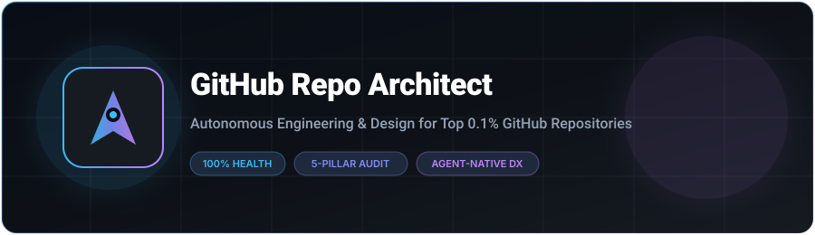
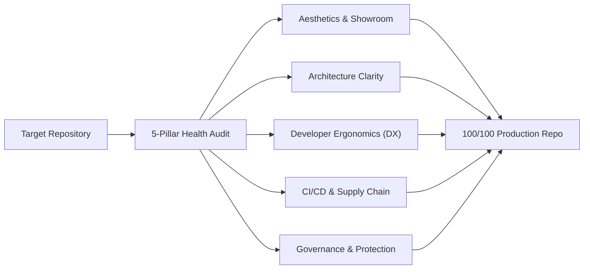

<p align="center">
  <picture>
    <source media="(prefers-color-scheme: dark)" srcset=".github/assets/hero-dark.svg">
    <source media="(prefers-color-scheme: light)" srcset=".github/assets/hero-light.svg">
    
  </picture>
</p>

<h1 align="center">GitHub Repo Architect</h1>

<p align="center">
  <b>Autonomous engineering skill to scaffold, design, and audit top-tier, production-grade GitHub repositories.</b>
</p>

<p align="center">
  
  
  
  
</p>

---

## Overview

GitHub Repo Architect elevates repositories to the standards of the top open-source projects. It automates technical branding, community governance, developer ergonomics, hardened CI/CD, and branch protection via the GitHub CLI.



---

## Key Capabilities

1. **Visual Showroom**: Responsive dark/light theme headers, flat-square status badges, and clear feature matrices.
2. **Architecture Transparency**: Native Mermaid diagrams for architecture, component trees, and request flows.
3. **Developer Ergonomics**: Preconfigured Dev Containers, stack-tailored `.gitignore`, `.editorconfig`, and `.gitattributes`.
4. **Community Health**: Modern YAML issue forms (`bug_report.yml`, `feature_request.yml`), rich PR templates, and security guidelines.
5. **Hardened Automation**: Least-privilege CI workflows, concurrency cancellation, and automated Dependabot grouping.
6. **Remote Protection**: Branch ruleset automation and repo metadata via `gh`.

---

## Installation

### Method 1: Automatic Installer

Run this in your terminal to install the skill for your local AI agent (Antigravity, Claude Code, Cursor, or global agents):

```bash
curl -fsSL https://raw.githubusercontent.com/h4rysh/github-repo-architect/main/scripts/install.sh | bash
```

### Method 2: Manual Installation

Copy `SKILL.md` into your agent's skills directory:

```bash
# Antigravity
mkdir -p ~/.gemini/config/skills/github-repo-architect
cp SKILL.md ~/.gemini/config/skills/github-repo-architect/

# Universal Agents directory
mkdir -p ~/.agents/skills/github-repo-architect
cp SKILL.md ~/.agents/skills/github-repo-architect/
```

---

## Usage

Once installed, invoke the skill in conversation with your agent:

- *"Audit this repository with `/github-repo-architect` and fix any missing governance or CI files."*
- *"Use `/github-repo-architect` to scaffold a production-grade open-source repo for this project."*
- *"Harden my repository's branch protection and setup issue forms using `/github-repo-architect`."*

---

## Repository Structure

```
├── .devcontainer/              # 1-click cloud development environment
├── .github/
│   ├── assets/                 # Theme-adaptive hero vector artwork
│   ├── ISSUE_TEMPLATE/         # Interactive YAML issue forms
│   ├── workflows/              # CI validation, labeling, and releases
│   ├── dependabot.yml          # Automated weekly dependency management
│   ├── labeler.yml             # Automatic path-based PR classification
│   └── pull_request_template.md# Comprehensive PR template
├── scripts/
│   └── install.sh              # Universal installation script
├── .editorconfig               # Cross-editor formatting consistency
├── .gitattributes              # Line-ending normalization and linguist tags
├── .gitignore                  # Clean developer hygiene rules
├── CONTRIBUTING.md             # Contributor guidelines
├── SECURITY.md                 # Vulnerability disclosure protocol
├── CODE_OF_CONDUCT.md          # Community guidelines
├── SKILL.md                    # Complete agent skill definition
└── README.md                   # Project documentation
```

---

## Contributing

Contributions and feedback are welcome! Please review [CONTRIBUTING.md](CONTRIBUTING.md) to get started.
